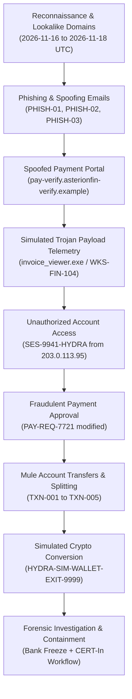

a# Operation Hydra: Unraveling a Multi-Vector Cyber Crime Involving Phishing, Spoofing & Financial Fraud

Academic Digital Forensics & Cybercrime Investigation Project (**Assignment 2 – Unit 2: Types of Cyber Crimes**) modeling a realistic, deterministic, 100% offline cybercrime investigation against a fictional Indian financial services firm: **Asterion Financial Services Pvt. Ltd.** (`asterionfin.example`).

**Author:** Parth Bhardwaj (Roll No. `2301730289`)  
**GitHub Repository:** https://github.com/bhardwajparth51/Cyber-Crime-Investigation-And-Digital-Forensics-Lab-Assignment-2-

---

## Investigation Scenario & Problem Statement

In **Operation Hydra** (`INC-2026-HYDRA-01`), an external threat group targets Asterion Financial's accounts payable and finance control staff on **20 November 2026** using lookalike domain infrastructure, spoofed email headers, a Trojan-style decoy invoice lure, unauthorized portal access, and rapid multi-tier payment laundering across Indian banking rails (`UPI`, `IMPS`, `NEFT`) culminating in a simulated virtual asset conversion.

This repository solves the investigation end-to-end by combining automated Python forensic tooling, cryptographic evidence preservation, cross-source timeline correlation, and rigorous Indian and international legal mapping.

## Objectives

- Decompose the campaign into distinct cybercrime categories mapped to Indian (**IT Act, 2000**; **BNS, 2023**; **CERT-In Directions, 2022**) and international (**Budapest Convention**; **18 U.S.C. § 1030**; **EU GDPR**) frameworks.
- Parse and analyze phishing `.eml` samples, differentiating embedded synthetic `Authentication-Results` headers from live DNS verification.
- Safely simulate Trojan-style decoy endpoint telemetry without active malware and extract deduplicated IOCs.
- Reconstruct fraudulent financial flows using directed graphs (`NetworkX`), identify mule account indicators, and reconcile recovered versus unrecovered losses.
- Correlate multi-source logs into a unified UTC timeline while sealing original evidence with SHA-256 integrity verification.

## Attack-Chain Overview



## Architecture & Repository Structure

```text
operation-hydra/
├── README.md
├── LICENSE
├── CONTRIBUTING.md
├── AUTHORS.md
├── requirements.txt
├── pyproject.toml
├── .github/workflows/quality.yml
├── docs/
│   ├── investigation-overview.md
│   ├── attack-chain.md
│   ├── legal-framework.md
│   ├── methodology.md
│   ├── evidence-handling.md
│   ├── tool-justification.md
│   ├── findings.md
│   ├── limitations.md
│   └── references.md
├── evidence/                  # Read-only synthetic artifacts + SHA-256 manifest
│   ├── emails/                # phishing-01.eml .. phishing-03.eml
│   ├── headers/               # email-01-headers.txt .. email-03-headers.txt
│   ├── network/               # dns-records.json, connection-logs.json, ip-observations.csv
│   ├── endpoint/              # execution-events.json, malware-observations.json
│   ├── authentication/        # login-events.csv
│   ├── financial/             # transactions.csv, account-ledger.csv, wallet-transfers.csv
│   ├── manifest.json
│   └── chain-of-custody.json
├── samples/malware/
│   ├── README.md
│   └── harmless-simulator/    # Event-driven simulator & Base64 text fixture (no real malware)
├── src/
│   ├── common/                # SHA-256 hashing & manifest verification
│   ├── email_analysis/        # RFC 5322 parsing, SPF/DKIM/DMARC interpretation, phishing risk
│   ├── infrastructure/        # Offline DNS/WHOIS/IP analysis + approval-gated live helpers
│   ├── malware_analysis/      # Trojan behavior classification, safe decoder, IOC extraction
│   ├── financial_analysis/    # Transaction validation, NetworkX tracing, mule indicators
│   └── correlation/           # Unified UTC timeline builder & evidence correlation table
├── scripts/
│   ├── generate_evidence.py   # Deterministic synthetic evidence generator
│   ├── verify_evidence.py     # Independent SHA-256 integrity verifier
│   └── analyze_campaign.py    # Single-command offline investigation pipeline
├── reports/
│   ├── final-investigation-report.md
│   ├── ioc-report.json
│   ├── figures/               # Generated fund-flow-graph.png
│   └── generated/             # Derived JSON outputs (kept separate from evidence/)
└── tests/                     # Offline pytest suite
```

## Key Features & Tools

- **Email & Infrastructure Forensics (`email.parser`, `dnspython`, `python-whois`):** Header mismatch detection, homoglyph similarity checks, `Received` hop extraction, and explicit `simulated_*` authentication labeling.
- **Safe Malware Simulation & IOC Extraction (`hashlib`):** Event-driven Trojan telemetry simulator, static Base64 JSON fixture decoder, differential classification (Trojan vs. RAT/keylogger/logic bomb/worm), and 23 deduplicated synthetic IOCs.
- **Financial Fraud Tracing (`pandas`, `NetworkX`, `matplotlib`):** Transaction validation, directed fund-flow graphing, rapid transfer (`<= 15m`) and splitting detection, and INR loss/recovery reconciliation.
- **Evidence Integrity & Correlation:** SHA-256 sealing of 15 synthetic artifacts, chain-of-custody logging, and 31-event UTC timeline reconstruction.

See [docs/tool-justification.md](docs/tool-justification.md) for detailed tool rationales, commands, and limitations.

## Installation & Offline Execution

Requires **Python 3.11+**. Runs 100% offline using the included synthetic dataset.

```bash
python -m pip install -r requirements.txt

# Verify SHA-256 integrity of sealed evidence (15/15 files)
python scripts/verify_evidence.py

# Run the complete forensic analysis pipeline
python scripts/analyze_campaign.py

# Run automated verification tests
pytest -v

# (Optional) Regenerate PNG diagrams and captured CLI output screenshots in reports/figures/
python scripts/generate_figures.py

# (Optional) Export the formal investigation report to Word (.docx)
python scripts/export_report_docx.py
```

## Investigation Visualizations & Captured Screenshots

| Figure / Screenshot | Purpose |
|---|---|
| [attack-chain-diagram.png](reports/figures/attack-chain-diagram.png) | Six-stage Operation Hydra attack and containment diagram |
| [timeline-sequence.png](reports/figures/timeline-sequence.png) | Multi-source UTC incident timeline plotted from `timeline.json` |
| [fund-flow-graph.png](reports/figures/fund-flow-graph.png) | Directed `NetworkX` financial layering and crypto simulation graph |
| [cli-pipeline-screenshot.png](reports/figures/cli-pipeline-screenshot.png) | Genuine captured stdout of `verify_evidence.py` and `analyze_campaign.py` |
| [pytest-verification-screenshot.png](reports/figures/pytest-verification-screenshot.png) | Genuine captured stdout of `pytest -v` |

*(Optional: regenerate synthetic evidence into a clean directory or with explicit confirmation via `python scripts/generate_evidence.py --force`.)*

## Sample Investigation Output

Genuine console output from `python scripts/analyze_campaign.py`:

```text
=== Operation Hydra Investigation Summary ===
Evidence integrity : VERIFIED
Emails analyzed    : 3 (all synthetic)
Malware class      : Simulated Trojan (Invoice Lure)
Total IOCs         : 23 -> reports/ioc-report.json
Financial impact   : INR 450,000.00 outflow | INR 200,000.00 frozen/recoverable | INR 250,000.00 unrecovered
Timeline events    : 31 sequenced UTC events
Derived outputs    : reports/generated
Fund-flow figure   : reports/figures/fund-flow-graph.png
```

## Legal Framework Overview

Operation Hydra maps seven cybercrime categories across:
- **India:** Information Technology Act, 2000 (**§§ 43, 66, 66C, 66D, 70B** & CERT-In April 2022 Directions) and Bharatiya Nyaya Sanhita, 2023 (**§§ 61, 318, 319, 336, 340**, replacing the IPC effective 1 July 2024).
- **International:** Council of Europe **Budapest Convention** (Arts. 2, 4, 5, 7, 8), **US CFAA** (`18 U.S.C. § 1030`, US-jurisdiction specific), and **EU GDPR** (Arts. 32–34, personal data breach governance).

Full statutory mapping, exclusions (`§ 66A`, `§ 66E`, `§§ 67/67B`), and jurisdictional limitations are documented in [docs/legal-framework.md](docs/legal-framework.md) and [reports/final-investigation-report.md](reports/final-investigation-report.md).

## Safety, Ethics & Limitations Disclaimer

- **100% Synthetic Data:** All organizations, employee names, `.example`/`.invalid` domains, RFC 5737 TEST-NET IPv4 addresses, endpoint events, bank accounts, and wallet strings are fictional.
- **No Active Malware or Network Probing:** No real malware, exploit payloads, keystroke capture, or unauthorized external scans exist in this repository.
- **No Real-World Attribution:** Simulated behavioral indicators do not establish criminal guilt or real-person identity. See [docs/limitations.md](docs/limitations.md).

## Authorship Declaration

Authored by **Parth Bhardwaj** (Roll No. `2301730289`) for Assignment 2 (Unit 2: Types of Cyber Crimes). All forensic scripts, synthetic fixtures, and analytical reports were created specifically for reproducible academic demonstration; no external threat infrastructure was queried during execution.

## References

See [docs/references.md](docs/references.md) for authoritative Indian Code, MeitY, CERT-In, Council of Europe, US DOJ, and EU GDPR citations.
