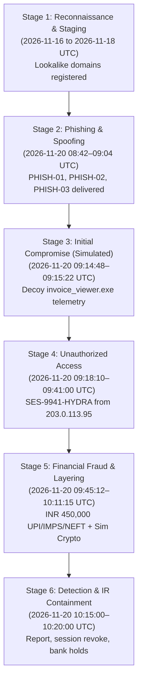

# Operation Hydra — Attack-Chain Reconstruction

The Operation Hydra scenario unfolds across six coordinated stages linking external staging infrastructure to internal session misuse and rapid financial laundering.

## End-to-End Campaign Flow

## Stage-by-Stage Forensic Mapping

| Stage | Window (UTC) | Observed Activity | Supporting Evidence |
|---|---|---|---|
| **1. Reconnaissance & Staging** | `2026-11-16T04:12:00Z` – `2026-11-18T11:30:00Z` | Adversary registers lookalike domains (`asteri0nfin.example`, `asterion-billing.invalid`, `asterionfin-verify.example`) targeting finance personnel (`EMP-FIN-104`, `EMP-FIN-108`). | [dns-records.json](../evidence/network/dns-records.json) |
| **2. Phishing & Spoofing** | `2026-11-20T08:42:10Z` – `2026-11-20T09:04:15Z` | Three targeted emails delivered: `PHISH-01` (homoglyph domain + `.pdf.html` lure), `PHISH-02` (direct `asterionfin.example` header spoof + `.zip`), and `PHISH-03` (unsolicited BEC mandate lure from lookalike portal domain). | [phishing-01.eml](../evidence/emails/phishing-01.eml), [phishing-02.eml](../evidence/emails/phishing-02.eml), [phishing-03.eml](../evidence/emails/phishing-03.eml) |
| **3. Initial Compromise (Simulated)** | `2026-11-20T09:14:48Z` – `2026-11-20T09:15:22Z` | User `EMP-FIN-104` interacts with decoy attachment on `WKS-FIN-104`. Simulated `invoice_viewer.exe` decodes Base64 config, touches `synthetic_browser_profile`, and beacons to `198.51.100.88`. | [execution-events.json](../evidence/endpoint/execution-events.json), [connection-logs.json](../evidence/network/connection-logs.json) |
| **4. Unauthorized Access** | `2026-11-20T09:18:10Z` – `2026-11-20T09:41:00Z` | Three failed login/MFA attempts (`AUTH-002`–`AUTH-004`) from external IP `203.0.113.95` precede unauthorized session `SES-9941-HYDRA` (`AUTH-005`) and modification/approval of `PAY-REQ-7721` (`AUTH-006`). | [login-events.csv](../evidence/authentication/login-events.csv), [ip-observations.csv](../evidence/network/ip-observations.csv) |
| **5. Financial Fraud & Layering** | `2026-11-20T09:45:12Z` – `2026-11-20T10:11:15Z` | `TXN-001` transfers `INR 450,000` via UPI to `MULE_ACC_01`, which splits funds within 7 minutes to `MULE_ACC_02` (`INR 270,000`) and `MULE_ACC_03` (`INR 175,000`). `MULE_ACC_02` routes `INR 250,000` to `CRYPTO_EXCH_SIM_01` (`WLT-SIM-001`/`002`). | [transactions.csv](../evidence/financial/transactions.csv), [account-ledger.csv](../evidence/financial/account-ledger.csv), [wallet-transfers.csv](../evidence/financial/wallet-transfers.csv) |
| **6. Detection & Response** | `2026-11-20T10:15:00Z` – `2026-11-20T10:30:00Z` | Finance Controller `EMP-FIN-108` reports discrepancy (`AUTH-007`). SOC revokes `SES-9941-HYDRA`, isolates `WKS-FIN-104`, triggers bank freeze (`INR 200,000` held including `TXN-005`), and seals SHA-256 evidence manifest. | [login-events.csv](../evidence/authentication/login-events.csv), [manifest.json](../evidence/manifest.json) |
