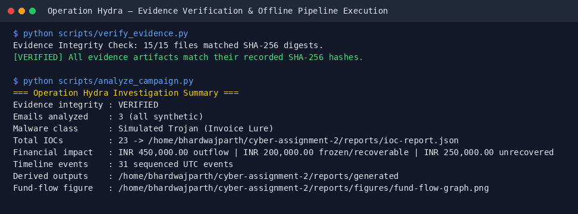
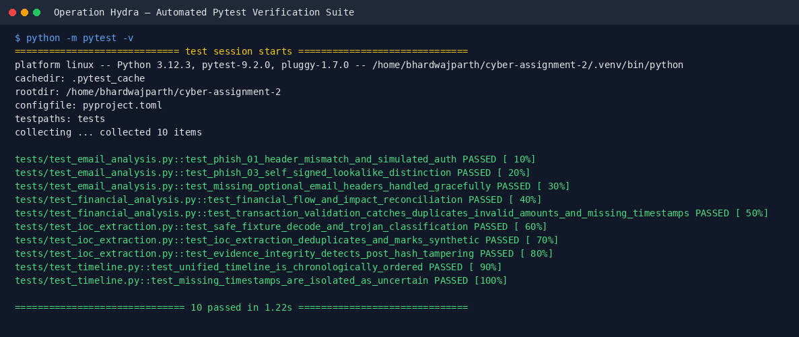
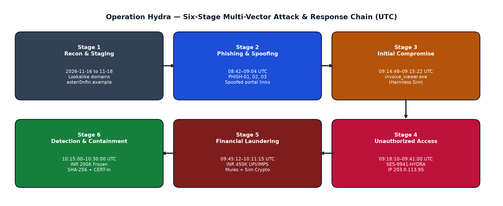
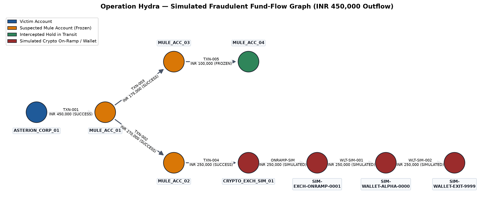
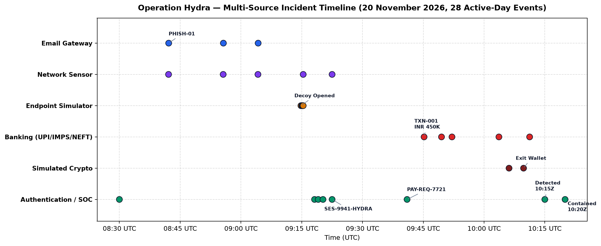

# Operation Hydra: Unraveling a Multi-Vector Cyber Crime Involving Phishing, Spoofing & Financial Fraud

**Formal Digital Forensics & Legal-Technical Investigation Report**  
**Prepared By:** Parth Bhardwaj (Roll No. `2301730289`)  
**Incident Reference:** `INC-2026-HYDRA-01`  
**Affected Entity (Fictional):** Asterion Financial Services Pvt. Ltd. (`asterionfin.example`)  
**Incident Date:** 20 November 2026 (UTC)  
**Classification:** Controlled Academic Simulation (Synthetic Evidence Dataset)  
**Repository:** [Operation Hydra — GitHub](https://github.com/bhardwajparth51/Cyber-Crime-Investigation-And-Digital-Forensics-Lab-Assignment-2-)  

---

## 1. Executive Summary

On 20 November 2026, Asterion Financial Services Pvt. Ltd. experienced a coordinated, multi-stage cybercrime simulation designated **Operation Hydra** (`INC-2026-HYDRA-01`). Over a 98-minute active operational window (`08:42:10Z` to `10:20:00Z`), an external threat group combined targeted spear-phishing, lookalike domain spoofing, a Trojan-style invoice decoy payload, unauthorized access to the corporate payment approval portal, and rapid multi-tier financial layering across Indian payment rails.

Forensic correlation of 15 SHA-256 sealed synthetic artifacts reconstructed 31 UTC-normalized events and extracted 23 Indicators of Compromise (IOCs). The attackers established three lookalike domains (`asteri0nfin.example`, `asterion-billing.invalid`, and `asterionfin-verify.example`) between 16 and 18 November 2026 before delivering three phishing emails (`PHISH-01`, `PHISH-02`, `PHISH-03`) to finance personnel. Following user interaction with a decoy invoice attachment on workstation `WKS-FIN-104`, unauthorized external session `SES-9941-HYDRA` originated from `203.0.113.95` and modified payment instruction `PAY-REQ-7721`, initiating an unauthorized `INR 450,000.00` UPI transfer (`TXN-001`) to `MULE_ACC_01`.

Within seven minutes of receipt, `MULE_ACC_01` split `INR 445,000.00` across two secondary mule accounts (`MULE_ACC_02` and `MULE_ACC_03`). Rapid escalation by Finance Controller Meera Nair (`10:15:00Z`) and SOC containment (`10:20:00Z`) enabled bank fraud holds that preserved **`INR 200,000.00` (44.44%)**, while **`INR 250,000.00` (55.56%)** was routed through `CRYPTO_EXCH_SIM_01` into fictional virtual asset wallet identifiers (`HYDRA-SIM-WALLET-EXIT-9999`) and remains unrecovered.

---

## 2. Incident Background

Asterion Financial Services Pvt. Ltd. is a fictional Indian financial services firm operating an internal mail gateway (`mail.asterionfin.example`, `192.0.2.10`), a corporate payment approval platform (`pay.asterionfin.example`, `192.0.2.25`), and a corporate settlement account (`ASTERION_CORP_01`, opening balance `INR 1,250,000.00`).

Prior to the fraud event, adversaries profiled finance department roles—specifically Accounts Payable Executive Rohan Deshmukh (`EMP-FIN-104`) and Finance Controller Meera Nair (`EMP-FIN-108`)—and tailored lures referencing overdue vendor invoices, November remittance batches, and vendor bank mandate updates. All domain names, IPv4 TEST-NET addresses, telemetry logs, financial accounts, and wallet strings belong strictly to a deterministic academic simulation.

---

## 3. Scope and Investigation Objectives

The investigation scope encompasses five synthetic telemetry domains acquired at `2026-11-20T10:30:00Z` by SOC Lead Vikram Kulkarni:
1. **Email & Header Forensics:** `phishing-01.eml` through `phishing-03.eml` and extracted raw headers.
2. **Infrastructure Telemetry:** `dns-records.json`, `connection-logs.json`, and `ip-observations.csv`.
3. **Endpoint Telemetry:** `execution-events.json`, `malware-observations.json`, and the harmless Base64 fixture `encoded_payload_fixture.txt`.
4. **Identity & Access Logs:** `login-events.csv` covering normal corporate baseline, failed login probes, unauthorized session activity, and SOC revocation.
5. **Financial Ledgers:** `transactions.csv`, `account-ledger.csv`, and `wallet-transfers.csv`.

The primary objectives were to verify evidence integrity, reconstruct a unified UTC timeline, classify observed offences under current Indian (IT Act, 2000; Bharatiya Nyaya Sanhita, 2023) and international frameworks, quantify recoverable versus unrecovered losses, and formulate actionable technical and governance controls.

---

## 4. Investigation Methodology

The investigation adhered to standard digital forensics preservation principles:
- **Cryptographic Sealing & Separation:** All 15 original artifacts in `evidence/` were verified via SHA-256 against [manifest.json](../evidence/manifest.json) prior to processing. Derived reports and visualizations were written strictly to `reports/generated/`, `reports/ioc-report.json`, and `reports/figures/`.
- **Offline Reproducibility:** All parsing, DNS/WHOIS profiling, malware telemetry classification, graph tracing (`NetworkX`), and timeline correlation executed offline via `scripts/analyze_campaign.py` without external API uploads or live network probing.
- **Evidentiary Caution:** Embedded `Authentication-Results` headers are tagged `simulated_*` (`live_dns_verified = False`) so simulated header text is never overstated as cryptographic proof. Similarly, timestamp correlation is distinguished from causal proof or personal attribution.

---

## 5. Cybercrime Classification

Operation Hydra decomposes into seven distinct cybercrime categories:

1. **Phishing:** Targeted invoice and mandate lures (`PHISH-01`–`PHISH-03`) designed to elicit attachment interaction and portal credential submission.
2. **Email and Website Spoofing:** Direct `From` domain spoofing (`PHISH-02` impersonating `asterionfin.example`) alongside homoglyph (`asteri0nfin.example`) and brand-compound (`asterionfin-verify.example`) infrastructure.
3. **Identity Theft / Digital Impersonation:** Misuse of `EMP-FIN-104`'s authentication credentials and session (`SES-9941-HYDRA`) to act as an authorized finance officer.
4. **Unauthorized Access:** External intrusion into `pay.asterionfin.example` from `203.0.113.95` following MFA/legacy fallback probes (`AUTH-002`–`AUTH-005`) and unauthorized tampering with `PAY-REQ-7721` (`AUTH-006`).
5. **Malware Distribution (Simulated Trojan):** Delivery of deceptive invoice/archive attachments resulting in simulated `invoice_viewer.exe` execution, synthetic browser profile access, and outbound beaconing.
6. **Financial Fraud and Payment Manipulation:** Unauthorized diversion of `INR 450,000.00` via UPI followed by rapid IMPS/UPI splitting across mule accounts and simulated virtual asset conversion.
7. **Unsolicited Bulk-Style Deceptive Email (Spamming):** Unsolicited high-urgency mandate notice (`PHISH-03`) delivered from freshly registered external infrastructure (`asterionfin-verify.example`).

---

## 6. Phishing and Spoofing Findings

Automated inspection (`src/email_analysis/`) flagged all three samples as **high risk** based on explainable header and content anomalies:

| Sample ID | Timestamp (UTC) | Sender (`From`) | `Reply-To` Mismatch | Simulated SPF / DKIM / DMARC | Key Indicators |
|---|---|---|---|---|---|
| `PHISH-01` | `2026-11-20T08:42:10Z` | `billing@asteri0nfin.example` | Yes (`asterion-billing.invalid`) | `fail` / `none` / `fail` | Homoglyph domain (`0` for `o`), double-extension `.pdf.html` attachment (`bf6c1fd6...`), portal URL |
| `PHISH-02` | `2026-11-20T08:55:40Z` | `finance-ops@asterionfin.example` | Yes (`asterion-billing.invalid`) | `softfail` / `fail` / `fail` | Direct corporate domain spoofing from `203.0.113.77`, mismatched `Return-Path`, `.zip` archive lure |
| `PHISH-03` | `2026-11-20T09:04:15Z` | `audit-desk@asterionfin-verify.example` | No | `pass` / `pass` / `none` | Attacker lookalike domain self-signed SPF/DKIM (`198.51.100.88`), absent DMARC policy, urgent BEC mandate |

Offline WHOIS profiling confirms that all three adversarial domains were registered between 16 and 18 November 2026 (`2` to `4` days prior to the attack) with redacted registrant information, contrasting sharply with `asterionfin.example` (registered `2019-03-14`, enforcing `v=DMARC1; p=reject`).

---

## 7. Malware Behavior Analysis

Endpoint telemetry (`execution-events.json`) and static decoding of `encoded_payload_fixture.txt` support classifying `MAL-HYDRA-SIM-001` as a **Simulated Trojan (Invoice Lure)**:

- **Observed Sequence:** Upon opening `Vendor_Invoice_INV-2026-8841.pdf.html` (`09:14:48Z`), `invoice_viewer.exe` launched from the user's `Temp` directory (`09:15:02Z`), decoded a Base64 staging configuration pointing to `pay-verify.asterionfin-verify.example` (`198.51.100.88`), attempted access against `synthetic_browser_profile` (`09:15:15Z`), and generated a single outbound beacon (`09:15:22Z`).
- **Differential Classification:** The payload is **not** classified as a **RAT** (no interactive remote shell or persistent C2 loop observed), **Keylogger** (no keyboard capture events), **Logic Bomb** (immediate execution rather than conditional/time-delayed trigger), or **Worm** (no autonomous lateral propagation).
- **IOC Extraction:** Across all sources, 23 unique synthetic IOCs were cataloged in [reports/ioc-report.json](../reports/ioc-report.json), all explicitly marked `origin: "synthetic"`.

---

## 8. Financial Fraud Reconstruction

Graph reconstruction (`src/financial_analysis/`) verified five fiat banking transactions (`TXN-001`–`TXN-005`) and two simulated virtual asset transfers (`WLT-SIM-001`–`WLT-SIM-002`):

### Flow Summary and Mule Indicators
- **Initial Diversion (`09:45:12Z`):** `TXN-001` moved `INR 450,000.00` (UPI, `UTR202611200001`) from `ASTERION_CORP_01` to `MULE_ACC_01`.
- **Rapid Splitting (`09:49:30Z` & `09:52:05Z`):** Within `258` and `413` seconds of receipt, `MULE_ACC_01` (`98.9%` pass-through, `0.00` opening balance) split `INR 270,000.00` (IMPS) to `MULE_ACC_02` and `INR 175,000.00` (UPI) to `MULE_ACC_03`.
- **Branch A — Unrecovered Off-Ramp (`10:03:40Z`–`10:09:45Z`):** `MULE_ACC_02` (`92.6%` pass-through) transferred `INR 250,000.00` (`TXN-004`, IMPS) within `850` seconds to `CRYPTO_EXCH_SIM_01`, represented in `wallet-transfers.csv` as `2,850.00 SIM-USDT` moving through `HYDRA-SIM-WALLET-ALPHA-0000` to `HYDRA-SIM-WALLET-EXIT-9999`.
- **Branch B — Bank Fraud Hold (`10:11:15Z`):** `MULE_ACC_03` initiated `INR 100,000.00` (`TXN-005`, NEFT) to `MULE_ACC_04`, which was intercepted and placed on `FROZEN` hold following SOC escalation.

### Financial Impact Reconciliation

| Category | Amount (INR) | Share of Initial Outflow | Status / Evidence |
|---|---:|---:|---|
| **Total Direct Fraudulent Outflow** | `450,000.00` | `100.00%` | `TXN-001` (`ASTERION_CORP_01` balance `1,250,000` -> `800,000`) |
| **Frozen / Recoverable Funds** | `200,000.00` | `44.44%` | `MULE_ACC_01` (`5,000`), `MULE_ACC_02` (`20,000`), `MULE_ACC_03` (`75,000`), `MULE_ACC_04` hold (`100,000`) |
| **Net Unrecovered Direct Loss** | `250,000.00` | `55.56%` | Routed via `TXN-004` to `CRYPTO_EXCH_SIM_01` / simulated exit wallet |

---

## 9. Attack Timeline

All 31 events across infrastructure, email, endpoint, authentication, and banking logs were normalized to UTC (`reports/generated/timeline.json`):

- **`2026-11-16T04:12:00Z` – `2026-11-18T11:30:00Z`:** Earliest observed events — registration of three synthetic lookalike domains.
- **`2026-11-20T08:30:00Z`:** Normal corporate baseline login by `EMP-FIN-104` from `192.0.2.50` (`SES-4401-CORP`).
- **`2026-11-20T08:42:10Z` – `09:04:15Z`:** Initial access indicators — delivery of `PHISH-01`, `PHISH-02`, and `PHISH-03`.
- **`2026-11-20T09:14:48Z` – `09:41:00Z`:** Suspected compromise window — decoy attachment opened (`09:14:48Z`), simulated Trojan execution and beacon (`09:15:02Z`–`09:15:22Z`), three failed external login probes from `203.0.113.95` (`09:18:10Z`–`09:20:15Z`), unauthorized login `SES-9941-HYDRA` (`09:22:30Z`), and modification/approval of `PAY-REQ-7721` (`09:41:00Z`).
- **`2026-11-20T09:45:12Z` – `10:11:15Z`:** Fund movement window (`TXN-001` through `TXN-005` and simulated wallet hops `WLT-SIM-001`–`002`).
- **`2026-11-20T10:15:00Z` – `10:20:00Z`:** Detection (`AUTH-007`) and containment (`AUTH-008`: session revocation, host isolation, bank hold).

---

## 10. Indian Legal Framework

Because the simulated incident occurs in November 2026, Indian criminal liability is governed by the **Information Technology Act, 2000 (IT Act)** and the **Bharatiya Nyaya Sanhita, 2023 (BNS)**, which replaced the Indian Penal Code (IPC) effective **1 July 2024**:

| Cybercrime | Evidence | Indian Provision | Historical IPC Context & Statutory Applicability |
|---|---|---|---|
| **Phishing & Spoofing** | `phishing-01..03.eml`, `dns-records.json` | IT Act § 66D; BNS §§ 318, 319, 336, 340 | BNS § 336/340 modernize IPC §§ 463/465/471 by explicitly covering *false electronic records*; § 66D penalizes cheating by personation using computer resources. |
| **Identity Theft** | `login-events.csv` (`AUTH-005`, `AUTH-006`) | IT Act § 66C; BNS § 319 | Penalizes dishonest use of another person's password or unique identification feature (`EMP-FIN-104` session misuse). |
| **Unauthorized Access & Malware** | `AUTH-002..006`, `execution-events.json` | IT Act § 43 (civil) & § 66 (criminal); § 70B(6) | § 43 provides civil compensation for unauthorized access/contaminant introduction; § 66 adds criminal liability for dishonest/fraudulent intent. § 70B(6) and **CERT-In Directions (28 April 2022)** mandate reporting within **6 hours**, 180-day log retention, and NIC/NPL NTP sync. |
| **Financial Fraud & Layering** | `transactions.csv`, `account-ledger.csv` | BNS § 318(4), § 61; IT Act §§ 66, 66D | BNS § 318(4) (replacing IPC § 420) covers dishonest inducement to deliver property (`INR 450,000`); BNS § 61 (replacing IPC § 120B) addresses multi-actor mule conspiracy. |
| **Unsolicited Spoofed Mail** | `phishing-03.eml` | IT Act § 66D; BNS § 318 | Actionable via deceptive/fraudulent elements; IT Act § 66A was struck down in *Shreya Singhal v. Union of India* (2015) and is inapplicable. |

**Statutory Exclusions:** IT Act **§ 66E** (bodily privacy) and **§§ 67/67A/67B** (obscene/CSAM material) do not apply to the facts of Operation Hydra and are intentionally excluded. Electronic evidence admissibility in Indian courts is governed by **Section 63 of the Bharatiya Sakshya Adhiniyam, 2023 (BSA)**.

---

## 11. International Legal Framework

- **Budapest Convention on Cybercrime (ETS No. 185):** Provides harmonized offence definitions relevant to Operation Hydra—**Article 2** (Illegal Access), **Article 4** (Data Interference), **Article 5** (System Interference), **Article 7** (Computer-Related Forgery), and **Article 8** (Computer-Related Fraud)—alongside expedited data preservation and Mutual Legal Assistance (MLA) mechanisms for cross-border infrastructure.
- **US Computer Fraud and Abuse Act (18 U.S.C. § 1030):** Penalizes unauthorized access (`§ 1030(a)(2)`), intent to defraud via protected computers (`§ 1030(a)(4)`), and transmission of damaging code (`§ 1030(a)(5)`). **Jurisdictional Limitation:** CFAA applies strictly to "protected computers" within US commerce/jurisdiction and does not govern purely domestic Indian offences.
- **EU General Data Protection Regulation (GDPR):** **Article 32** requires appropriate technical security controls, **Article 33** mandates supervisory authority notification within **72 hours** of personal data breach awareness, and **Article 34** governs high-risk data subject notifications. **Jurisdictional Limitation:** GDPR is a data-protection regulatory regime applicable only if EU/EEA personal data is processed or EU residents are targeted—it is not a universal cybercrime criminal code.

---

## 12. Stakeholder Impact

- **Direct Financial Loss:** `INR 450,000.00` initial corporate outflow, reduced to `INR 250,000.00` net unrecovered direct loss after bank holds preserved `INR 200,000.00`.
- **Potential / Indirect Losses:** Incident response labor, forensic preservation costs, legal and CERT-In compliance overhead, vendor settlement delays, and potential customer churn if payment integrity concerns become public.
- **Employee Psychological Impact:** Targeted finance employees (`EMP-FIN-104`, `EMP-FIN-108`) frequently experience acute stress, self-blame, or fear of disciplinary sanction following social engineering; organizations must treat targets as victims of deception unless intentional collusion is established.
- **Customer Trust & Reputation:** Lookalike domains impersonating Asterion Financial threaten client confidence in billing communications and payment portals.
- **Operational Disruption & Banking Impact:** Isolating `WKS-FIN-104`, revoking sessions, and freezing `MULE_ACC_01`–`04` temporarily disrupt accounts payable workflows and require multi-bank fraud coordination.

---

## 13. Ethical Considerations

- **Employee Privacy & Monitoring Limits:** Endpoint and email investigations must be scoped strictly to incident indicators (`WKS-FIN-104`, `SES-9941-HYDRA`) rather than indiscriminate surveillance of personal employee communications.
- **Crypto Tracing & Attribution Uncertainty:** Virtual asset cluster analysis cannot establish the identity of a real human owner without regulated exchange KYC records and judicial process; investigators must never accuse unverified individuals.
- **Third-Party Data Exposure:** Raw `.eml` attachments or internal payment logs must never be uploaded to public reputation portals (e.g., VirusTotal) where third parties could access confidential corporate or customer data.
- **False Positives & Automated Scoring:** Automated phishing or mule flags must be paired with human verification before freezing legitimate customer accounts or disciplining staff.
- **Responsible Disclosure & Honeypots:** Any defensive deception or takedown notification to registrars/hosting providers must avoid unlawful counter-hacking and respect jurisdictional boundaries.

---

## 14. Incident Response Recommendations

1. **Immediate Containment & Credential Hygiene:** Revoke all active sessions for `EMP-FIN-104`, enforce full credential rotation, and re-image `WKS-FIN-104` after preserving volatile/disk artifacts.
2. **Statutory Reporting (CERT-In):** Submit initial incident notification to CERT-In within the mandatory **6-hour window** under Section 70B(6) Directions (28 April 2022), preserving NIC/NPL-synchronized logs for 180+ days.
3. **Financial Recovery & Law Enforcement Escalation:** Maintain formal lien/freeze requests across `MULE_ACC_01`–`04`, file a cybercrime complaint via the National Cyber Crime Reporting Portal (1930 / `cybercrime.gov.in`) referencing `UTR202611200001`–`0005`, and issue preservation requests to the virtual asset exchange (`CRYPTO_EXCH_SIM_01`).
4. **Evidence Preservation Policy:** Formalize SHA-256 sealing, write-once storage for raw logs, and BSA § 63 certification workflows for real incidents.

---

## 15. Preventive Measures (Technical & Policy)

- **Email Authentication Enforcement:** Maintain `p=reject` DMARC policies, monitor newly registered homoglyph/lookalike domains, and apply external-sender banners plus attachment sandboxing for `.html` and `.zip` payloads.
- **Phishing-Resistant MFA:** Replace legacy password/SMS fallback mechanisms (`AUTH-004`) with FIDO2/WebAuthn hardware keys and conditional access policies blocking unrecognized external IPs (`203.0.113.95`) from accessing `pay.asterionfin.example`.
- **Least Privilege & Dual-Control Payment Governance:** Enforce strict maker-checker segregation and out-of-band callback verification for any vendor bank mandate change (`PAY-REQ-7721`) or high-value UPI/IMPS disbursement.
- **Endpoint Detection & Egress Filtering:** Restrict execution of binaries from user `%TEMP%` directories (`invoice_viewer.exe`) and alert on anomalous credential-store access.
- **Role-Specific Awareness Training:** Conduct quarterly spear-phishing and UPI/BEC fraud drills specifically tailored to finance and accounts payable teams.

---

## 16. Conclusion

Operation Hydra illustrates how modern financial cybercrime bridges technical deception and rapid payment-rail laundering. Although spoofed emails and a Trojan-style decoy initiated the compromise, the decisive financial impact resulted from fallback authentication weaknesses and single-session payment approval authority. Rapid detection (`10:15:00Z`) and bank coordination recovered `44.44%` of diverted funds, demonstrating both the value of sub-hour response playbooks and the urgency of phishing-resistant MFA, strict dual-authorization payment controls, and immutable forensic logging.

---

## 17. References

1. Information Technology Act, 2000 (India Code) — https://www.indiacode.nic.in/handle/123456789/1999
2. Ministry of Electronics and Information Technology (MeitY), Cyber Laws — https://www.meity.gov.in/content/cyber-laws
3. CERT-In Directions under Section 70B(6) of the IT Act, 2000 (28 April 2022) — https://www.cert-in.org.in/PDF/CERT-In_Directions_70B_28.04.2022.pdf
4. Bharatiya Nyaya Sanhita, 2023 (India Code) — https://www.indiacode.nic.in/
5. Bharatiya Sakshya Adhiniyam, 2023, Section 63 (India Code) — https://www.indiacode.nic.in/
6. Council of Europe, Budapest Convention on Cybercrime (ETS No. 185) — https://www.coe.int/en/web/cybercrime/the-budapest-convention
7. United States Computer Fraud and Abuse Act, 18 U.S.C. § 1030 — https://www.law.cornell.edu/uscode/text/18/1030
8. European Union General Data Protection Regulation (EU) 2016/679, Articles 32–34 — https://eur-lex.europa.eu/eli/reg/2016/679/oj
9. IETF RFC 2606 (*Reserved Top Level DNS Names*) & RFC 5737 (*IPv4 Address Blocks Reserved for Documentation*).

---

## Repository & Submission Details

- **Submitted By:** Parth Bhardwaj (Roll No. `2301730289`)
- **Assignment:** Assignment 2 – Unit 2: Types of Cyber Crimes (`Operation Hydra`)
- **GitHub Repository:** https://github.com/bhardwajparth51/Cyber-Crime-Investigation-And-Digital-Forensics-Lab-Assignment-2-
